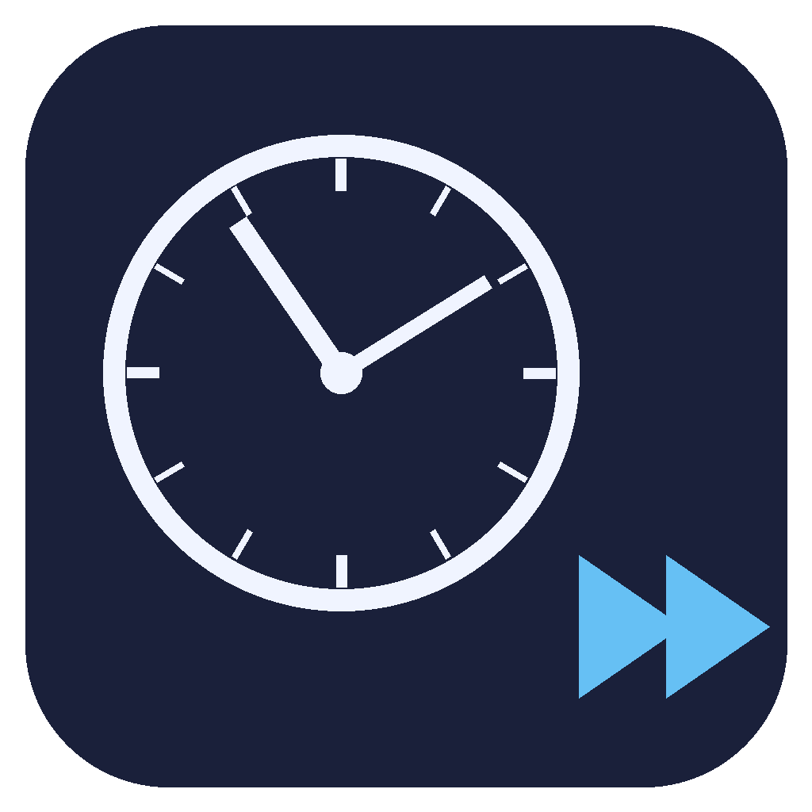

# Time Changer for Steam Deck

[简体中文](README.zh-CN.md)

<p align="center">
  
</p>

A [Decky Loader](https://github.com/SteamDeckHomebrew/decky-loader) plugin to change the Steam Deck's system time from Game Mode — quick time offsets, a custom date & time picker, and one-click NTP restore.

No desktop mode, no terminal: shift the clock right from the Quick Access Menu. Useful for games with date-triggered content (daily events, date-dependent achievements), emulator titles with real-clock mechanics, or testing.

## Features

- Live system clock with NTP sync status
- Quick offsets: ±30 min / ±1 hour
- Custom date & time picker — defaults to the current time, handles month lengths and leap years
- One-click restore to real time (re-enables NTP auto-sync)
- UI in English and 简体中文, following your Steam client language

## How It Works

The Python backend runs as root (`plugin.json` → `flags: ["root"]`) and wraps `timedatectl`:

| Action | Commands |
|---|---|
| Set time | `timedatectl set-ntp false` → `timedatectl set-time @<epoch>` (UTC seconds, timezone-independent) |
| Restore | `timedatectl set-ntp true` — systemd-timesyncd resyncs once online |

## Install

### From URL (recommended, no desktop mode needed)

1. Download `decky-time-changer-v*.zip` from [Releases](../../releases), or serve it from any HTTP host your Deck can reach
2. On the Deck, open the Decky menu → ⚙️ settings → **GENERAL** → **DEVELOPER** (enable Developer Mode first if hidden)
3. Click **Install plugin from URL** and paste the zip URL

### From source

```bash
git clone https://github.com/nanwangjkl/decky-time-changer.git && cd decky-time-changer
pnpm install && pnpm run build   # produces dist/
./deploy.sh zip                  # packages out/decky-time-changer-v*.zip
```

## Warnings

- **While the clock is skewed, HTTPS validation fails** — Steam store and online features may break. This is expected; click *Restore Real Time* to fix.
- Restore requires network connectivity (NTP needs to reach a time server).
- The Steam client may keep displaying the old time until restarted; the system clock itself is changed immediately.
- Setting time automatically disables NTP so the system doesn't snap back — the plugin shows a "manual time" state so you don't forget.

## Development

Requirements: Node ≥ 18, pnpm ≥ 8, Python 3 (backend only runs on the Deck).

```bash
pnpm run check      # typecheck, frontend/backend/deploy regression tests, shell syntax
./deploy.sh          # build + rsync to Deck + restart plugin_loader
./deploy.sh zip      # package an installable zip into out/
./deploy.sh restart  # restart plugin_loader on the Deck only
```

Connection settings come from environment variables (`DECK_IP`, `DECK_USER`, `DECK_PORT`, `DECK_KEY`/`DECK_PASS`) or a `.deploy.env` file — see `deploy.sh`. VSCode tasks (`build` / `deploy` / `restart-decky` / `zip`) are also available in `.vscode/tasks.json`.

Backend logs: `~/homebrew/logs/decky-time-changer/plugin.log` on the Deck.

Regression tests mock the Decky API, system commands, and SSH; they do not change the local or Deck system clock.

### Project structure

```
plugin.json        plugin metadata (root flag)
main.py            Python backend — timedatectl wrapper
src/index.tsx      frontend UI (@decky/ui)
src/translations.ts  en / zh-CN dictionaries
dist/              frontend build output (rollup)
deploy.sh          build & deploy script
```

## License

BSD 3-Clause — see [LICENSE](LICENSE).
